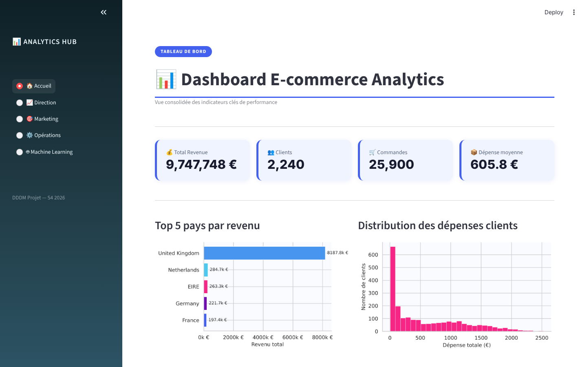
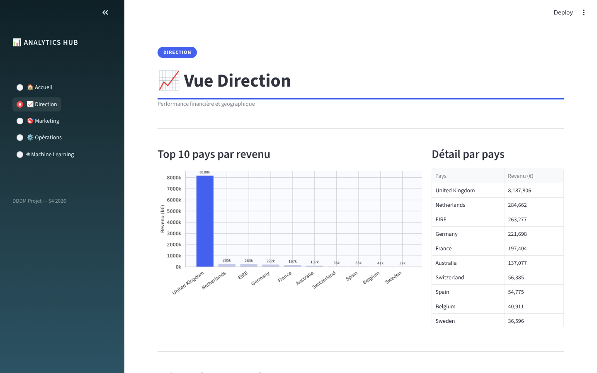
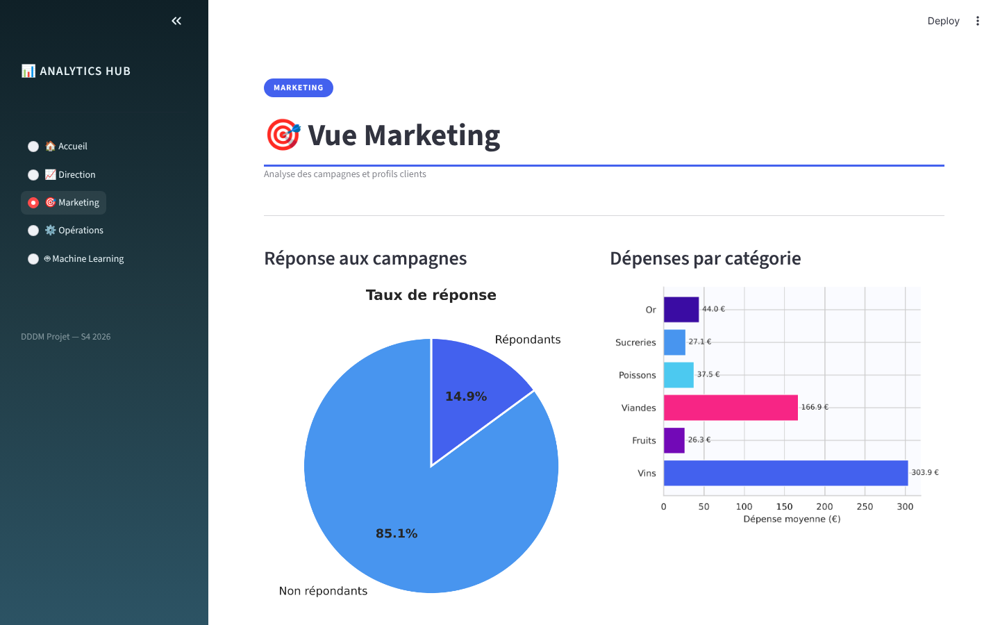
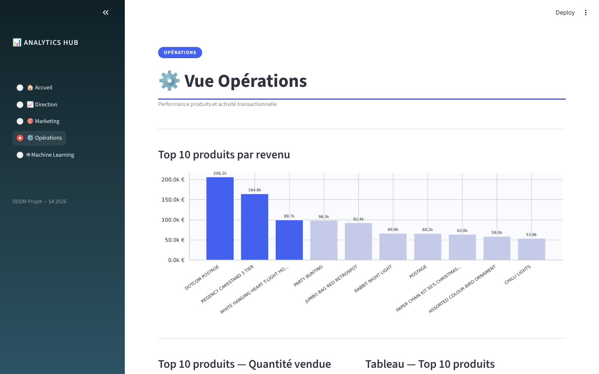
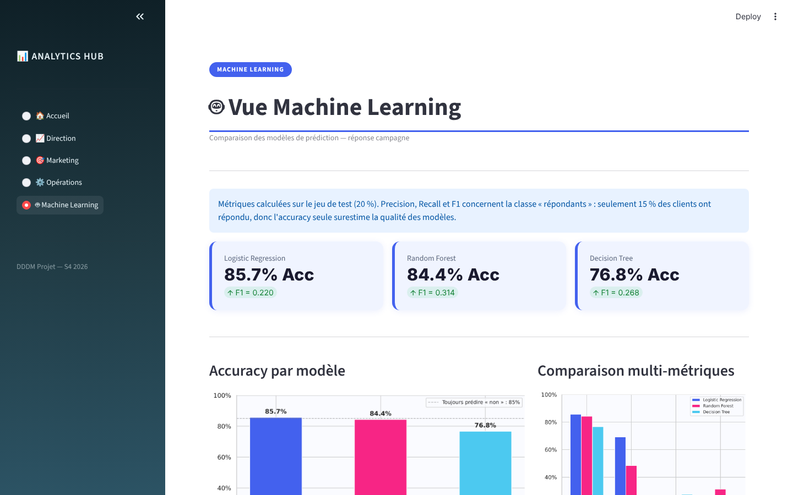

# Data-Driven Decision Making — E-commerce & Marketing

Analyse de **541 909 transactions e-commerce** et de **2 240 clients** pour aider à la décision marketing : qui sont les clients les plus rentables, comment les segmenter, et qui va répondre à une campagne.

Le projet suit tout le cycle : définition des KPIs, nettoyage des données, analyse exploratoire, segmentation, modèles de prédiction, explicabilité, plan d'A/B testing et tableau de bord Streamlit.


---

## Sommaire

- [Aperçu du dashboard](#aperçu-du-dashboard)
- [Données](#données)
- [Démarche](#démarche)
- [Résultats principaux](#résultats-principaux)
- [Structure du projet](#structure-du-projet)
- [Lancer le projet](#lancer-le-projet)
- [Limites et prochaines étapes](#limites-et-prochaines-étapes)
- [Équipe](#équipe)

---

## Aperçu du dashboard

| Accueil | Direction |
|---|---|
|  |  |

| Marketing | Opérations |
|---|---|
|  |  |

| Machine Learning |
|---|
|  |

---

## Données

| Dataset | Contenu | Taille | Source |
|---|---|---|---|
| `data_Orders.csv` | Transactions d'un site e-commerce (facture, produit, quantité, prix, client, pays) | 541 909 lignes | Online Retail Dataset (Kaggle) |
| `Customers.csv` | Profil et comportement des clients (revenu, âge, dépenses par catégorie, achats web/magasin, réponse aux campagnes) | 2 240 clients | Customer Personality Analysis (Kaggle) |

Les deux jeux de données n'ont **pas d'identifiant commun** : le premier sert à l'analyse des ventes, le second à la segmentation et à la prédiction.

---

## Démarche

**1. Problème métier et KPIs**
Identifier les clients rentables, améliorer les campagnes marketing et suivre le chiffre d'affaires.

**2. Collecte et audit**
Cartographie des sources, dictionnaire de données, limites et biais.

**3. Nettoyage**
- suppression de 5 268 doublons ;
- suppression des transactions sans identifiant client (401 604 lignes restantes) ;
- revenus manquants remplacés par la moyenne ;
- création des variables `Revenue`, `Age` et `Total_Spending`.

**4. Analyse exploratoire**
Distribution du chiffre d'affaires, top pays et top produits, corrélations, valeurs aberrantes, et un **test de Student** (revenu élevé vs faible → dépenses significativement différentes, p < 0,001).

**5. Segmentation**
**K-Means** sur revenu, dépenses et âge (données normalisées). Le nombre de groupes, **4**, est choisi avec la méthode du coude.

**6. Prédiction de la réponse aux campagnes**
- trois modèles comparés : Régression logistique, Random Forest, Arbre de décision ;
- validation croisée à 5 plis et AUC-ROC ;
- réglage des hyperparamètres avec GridSearchCV ;
- explicabilité globale et locale avec **SHAP**.

**7. Décision**
Recommandations, plan d'**A/B testing** (H0/H1, métriques, durée) et indicateurs de suivi d'impact.

---

## Résultats principaux

**Segments clients (K-Means)**

| Segment | Revenu moyen | Dépense moyenne | Âge moyen |
|---|---|---|---|
| Petits budgets, plus jeunes | 34 405 | 149 | 49 |
| Petits budgets, plus âgés | 45 711 | 270 | 68 |
| Fortes dépenses, plus âgés | 72 410 | 1 250 | 70 |
| Fortes dépenses, plus jeunes | 75 018 | 1 282 | 49 |

**Modèles de prédiction** (jeu de test : 448 clients)

| Modèle | Accuracy | F1 (répondants) |
|---|---|---|
| Régression logistique | 85,7 % | 0,22 |
| Random Forest | 84,4 % | 0,31 |
| Arbre de décision | 76,8 % | 0,27 |

Autres résultats de la régression logistique :
- **AUC-ROC 0,71** ;
- validation croisée : 85,4 % en moyenne.

Seulement **15 % des clients** ont répondu à une campagne, et un modèle qui répond toujours « non » obtient déjà 85 % d'accuracy. L'**AUC** et le **F1** sur les répondants sont donc les vrais indicateurs : les modèles classent correctement les clients mais détectent encore peu de répondants.

**Facteurs clés (coefficients et SHAP)**
- Le nombre d'**achats web** augmente la probabilité de réponse.
- Le nombre d'**achats en magasin** la diminue.

---

## Structure du projet

```
Data-Driven/
├── analysis_business/
│   └── notebooks/analysis_business.ipynb   # Audit, nettoyage, EDA, test statistique, K-Means
├── ml_dashboard/
│   ├── notebooks/ml_modeling.ipynb         # Modèles, validation, SHAP, A/B testing
│   └── dashboard/app.py                    # Dashboard Streamlit (5 vues)
├── shared_data/
│   ├── data_Orders.csv
│   └── Customers.csv
├── reports/
│   ├── AB_Test_Plan_DDDM.docx              # Plan d'A/B testing
│   └── presentation_data_story.pdf         # Présentation des résultats
├── docs/screenshots/                       # Captures du dashboard
├── requirements.txt
└── README.md
```

---

## Lancer le projet

```bash
git clone https://github.com/ayanasser53/Data-Driven.git
cd Data-Driven
pip install -r requirements.txt
```

**Dashboard**
```bash
streamlit run ml_dashboard/dashboard/app.py
```
Puis ouvrir http://localhost:8501

**Notebooks**
```bash
jupyter notebook
```
Les chemins vers les données sont relatifs : les notebooks fonctionnent directement après le clonage.

---

## Limites et prochaines étapes

- **Classes déséquilibrées** : tester `class_weight="balanced"`, le rééchantillonnage (SMOTE) ou un autre seuil de décision pour mieux détecter les répondants.
- **Pas de lien entre les deux datasets** : une base où transactions et profils partagent le même identifiant permettrait une segmentation RFM complète.
- **Transactions annulées** (quantités négatives) : à traiter séparément dans le calcul du chiffre d'affaires.
- Déployer le dashboard sur Streamlit Community Cloud.

---

## Équipe

Projet réalisé en binôme à l'**ENSIAS** (Génie Logiciel, 2ᵉ année) :

- Aya Nasser
- *[Nom du binôme]*
